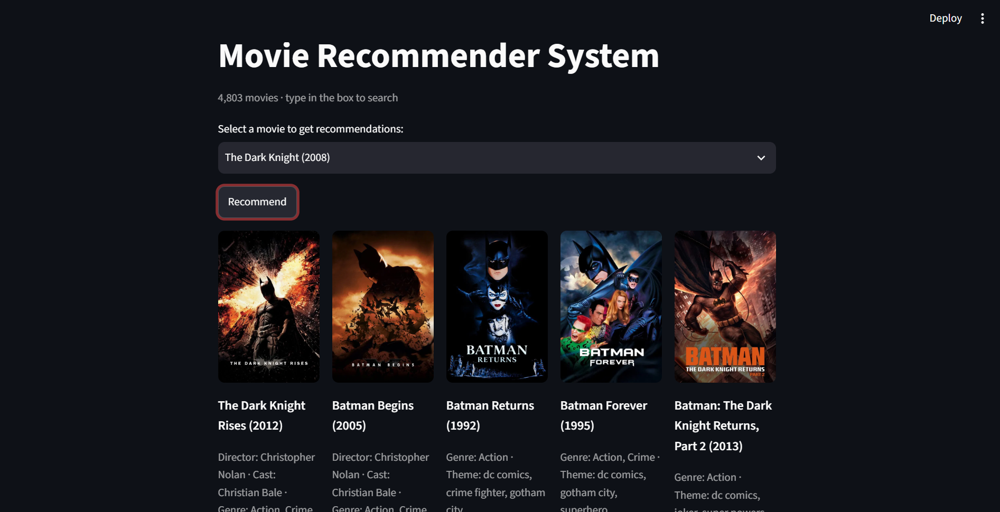

# Movie Recommender System

A content-based movie recommender covering **4,803 movies** from the TMDB 5000 dataset. Pick any movie and get 5 similar ones, with posters and a short explanation of **why** each was recommended.

**Live demo:** _coming soon_



## Credit

The starting point (tag building, CountVectorizer, cosine similarity) follows the CampusX "Movie Recommender System" tutorial. Everything under **My changes** is my own work on top of it.

## My changes

- **"Why recommended" explanations.** Each result shows what it shares with the selected movie: director, cast, genres, and themes. For example, *Avatar → The Terminator* shows *Director: James Cameron · Genre: Action, Science Fiction*.
- **Compared 4 model versions with simple scores** and picked the best one (details below).
- **Fixed a data bug.** The tutorial merges the two data files on `title`, which created duplicate rows. I merge on `movie_id` instead.
- **Removed noise tags.** TMDB keywords like `duringcreditsstinger` (a scene during the credits) are not real themes but were adding similarity between unrelated movies.
- **Weighted genres and director** more than plot words.
- **Fixed the poster bug.** The tutorial's TMDB URL was broken, so every poster failed.
- **Cut the deploy size from 176 MB to 96 KB.** The app only needs the top 5 matches per movie, so I save just those instead of the full similarity matrix.
- **Moved the API key out of the code** into Streamlit secrets.
- **Better movie list:** sorted A to Z, with release years so movies with the same name (like the different *Batman* films) are easy to tell apart.

## Model comparison

I tested 4 versions. "Plain" means every word counts once. "Weighted" means genres and director count twice.

| Method | Shares a genre | Genre overlap | Shares cast or director |
|---|---|---|---|
| Count (plain), the tutorial's method | 88.9% | 49.5% | 6.4% |
| TF-IDF (plain) | 77.2% | 37.0% | 10.3% |
| **TF-IDF (weighted), chosen** | **87.0%** | **46.7%** | **30.4%** |
| Count (weighted) | 98.1% | 73.8% | 8.8% |

Scores are averaged over the top 5 recommendations for all 4,803 movies.

**What I learned:**

- **TF-IDF alone made results worse.** TF-IDF lowers the weight of words that appear in many movies. Genre words like "action" appear in hundreds, so it learned to ignore genres.
- **Weighting fixed that.** Counting genres and director twice brought genre matching back up, and matches on cast or director went from 6.4% to 30.4%.
- **The highest score was a trap.** Count (weighted) scored best on genres, but its results were worse: for *Avatar* it dropped *Aliens*, and for *The Dark Knight Rises* it dropped 3 Batman films. It became a "same genre" matcher. I chose based on all 3 scores plus checking real examples, not one number.

**Example: Avatar**

| Method | Top 5 |
|---|---|
| Count (plain) | Aliens, Falcon Rising, Aliens vs Predator: Requiem, Titan A.E., Independence Day |
| **TF-IDF (weighted)** | **Aliens, Falcon Rising, The Terminator, Terminator 2, The Abyss** |
| Count (weighted) | Small Soldiers, Jupiter Ascending, Krull, Ender's Game, Mad Max Beyond Thunderdome |

## Known limits

- **Word traps still happen.** *Toy Story 3 → The 40-Year-Old Virgin* (its plot mentions action figures) and *Spider-Man 3 → Arachnophobia* (spiders). The model matches words, not meaning.
- **My scores are rough checks, not real user feedback.** Sharing a genre or director is a reasonable sign of a good match, but only real users could prove which version is truly best.
- **Fixed dataset.** It covers 4,803 movies up to about 2017. Newer movies are not included.

## How it works

1. **Data:** merge the TMDB movies and credits files on `movie_id`.
2. **Clean:** keep genres, keywords (minus noise tags), top 3 cast, director, and plot overview.
3. **Tags:** combine them into one text per movie, with genres and director repeated twice, then stem the words.
4. **Vectors:** TF-IDF on the top 5,000 words, with English stop words removed.
5. **Similarity:** cosine similarity between every pair of movies; save each movie's top 5.
6. **App:** show the top 5 with posters from the TMDB API and the shared-feature explanation.

## Tech stack

- **App:** Python, Streamlit, Pandas, NumPy, Requests
- **Model building (notebook):** Pandas, NumPy, NLTK, Scikit-learn

## Project files

| File | Purpose |
|---|---|
| `app.py` | The Streamlit app |
| `movie_dict.pkl` | Movie IDs, titles, and years |
| `top5.pkl` | Top 5 matches for each movie |
| `meta.pkl` | Genres, cast, director, and keywords for explanations |
| `movie-recommender-system.ipynb` | Model building and comparison |
| `requirements.txt` | Packages needed to run the app |

## Run locally

1. Clone the repo:
```bash
   git clone https://github.com/Monalisakondpan/movies-recommender-system.git
   cd movies-recommender-system
```
2. Install packages:
```bash
   pip install -r requirements.txt
```
3. Get a free API key from [TMDB](https://www.themoviedb.org/settings/api), then create `.streamlit/secrets.toml`:
```toml
   TMDB_API_KEY = "your_key_here"
```
4. Run:
```bash
   streamlit run app.py
```

To rebuild the model, download the [TMDB 5000 dataset from Kaggle](https://www.kaggle.com/datasets/tmdb/tmdb-movie-metadata) and run the notebook.

## Next steps

- Use sentence embeddings so the model matches meaning instead of exact words, which should fix word traps like *Arachnophobia*.
- Let users choose how many recommendations to see.
- Add filters by genre or year.